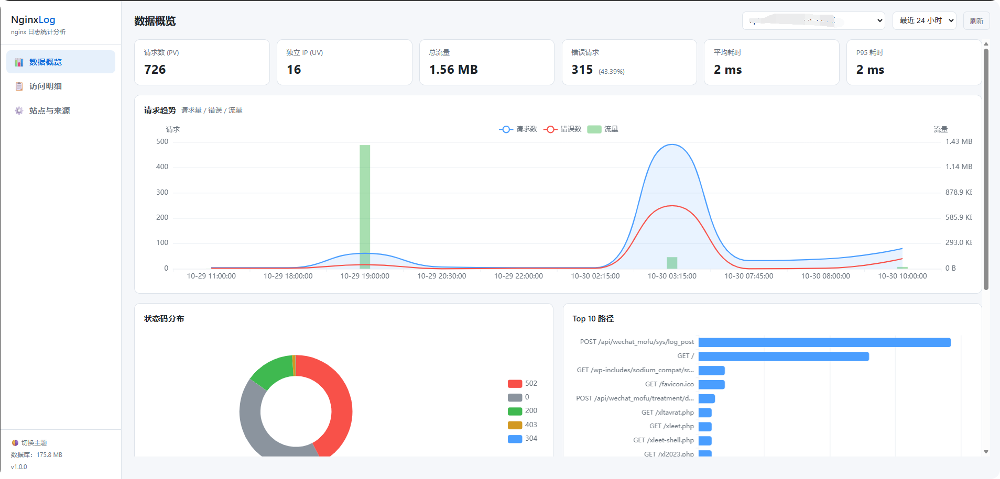
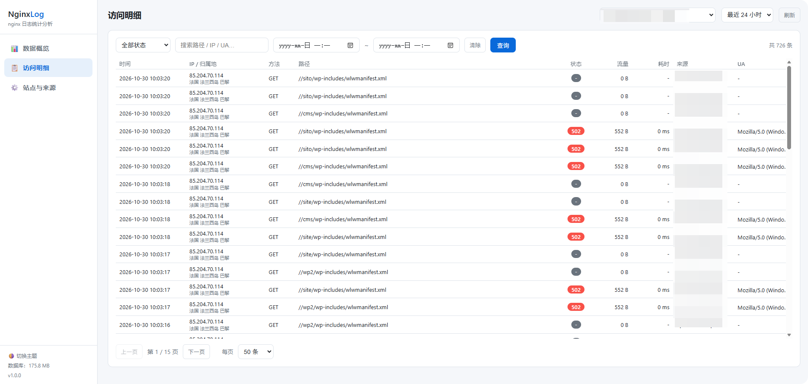
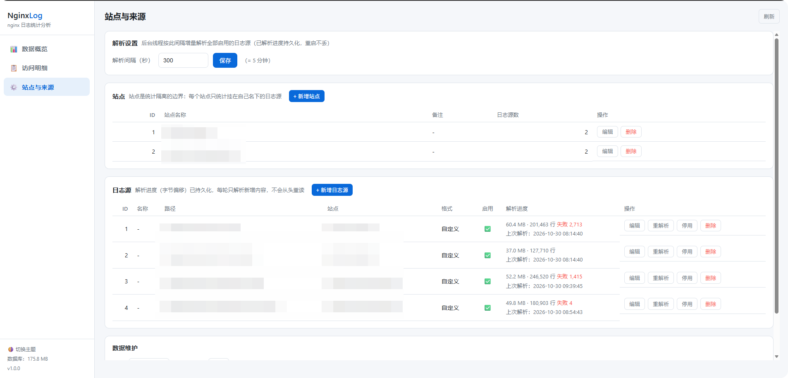

# NginxLog · nginx 日志分析服务

基于 **Rust + Axum + SQLite** 的轻量级 nginx 日志分析与可视化服务。后台线程周期性增量解析 nginx 访问日志（支持自定义 `log_format` 正则编译与 JSON 格式自动检测），结构化存入 SQLite（WAL 模式），并通过内置 Web 仪表盘提供多站点统计概览、访问明细查询与在线配置管理，无需重启即可热生效。

> 单个静态编译二进制 + SQLite，无外部依赖，适合部署在任意 Linux 服务器 / Docker 环境中。

## ✨ 功能特性

- **📈 数据概览**：PV / UV / 流量 / 错误请求 / 平均与 P95 响应耗时 KPI 卡片；请求趋势（请求数、错误数、流量）时序图；状态码分布环形图；Top 10 路径 / Top IP 排行；时间范围（1h / 6h / 24h / 7d / 30d）与站点切换。
- **📋 访问明细**：逐条访问记录列表（时间、IP 及归属地、方法、路径、状态、流量、耗时、来源、UA），支持状态筛选、关键词搜索（IP / 路径 / UA）、时间段过滤与分页。
- **🛠 站点与来源**：网页在线管理站点与 nginx 日志源（路径、log_format、解析间隔），保存后热生效；显示各源解析进度（字节偏移、行数、失败数、最近错误）；支持手动重解析、停用、删除。
- **🔁 增量解析**：记录字节偏移断点，自动处理日志轮转与文件末尾半行；进度持久化，服务重启后从断点继续，不重读历史；大文件解析期间每 5000 行实时刷新进度。
- **🌍 IP 归属地**：基于 ip9.com.cn 在线查询（支持 IPv6），带本地滑动窗口限速、失败指数退避与 SQLite 永久缓存。
- **🧹 自动运维**：可配置的旧日志数据自动清理（清理后可选 VACUUM 整理碎片）、每日定时 WAL checkpoint，均在后台任务中同天幂等执行、重启补执行。
- **🔐 登录保护**：HMAC-SHA256 签名 cookie 会话，支持滑动续期（持续使用无需重新登录）；账号密码留空可关闭保护（内网调试）。

## 📷 界面截图

**数据概览**



**访问明细**



**站点与来源（配置管理）**



## 🧰 技术栈

| 组件 | 说明 |
|------|------|
| Rust 2024 / Tokio / Axum 0.8 | 异步 Web 服务 |
| rusqlite（bundled SQLite，WAL 模式） | 日志存储与 SQL 聚合统计 |
| regex | `log_format` 字符串编译为解析正则 |
| flexi_logger | 日志输出 |
| shadow-rs | 构建信息注入（`/version` 接口可见） |
| 原生 HTML + ECharts | 仪表盘前端（无 Node 构建步骤） |

## 🚀 快速开始

### 方式一：源码编译运行

要求 Rust 1.85+（edition 2024）。

```bash
# 本地直接运行（默认监听 config.toml 中的 [server] 端口）
cargo run --release

# 或编译 Linux 静态二进制（musl，适合容器 / 服务器部署）
cargo build --release --target x86_64-unknown-linux-musl
# 产物：target/x86_64-unknown-linux-musl/release/nginx_log_rs
```

也可使用项目自带脚本：

```bash
./build.sh build      # 编译 musl release 二进制
./build.sh run        # 运行（RUST_LOG=info）
./build.sh run -d     # 运行（RUST_LOG=debug）
```

启动后访问 `http://<host>:<port>/`（默认配置为 `80`），使用 `config.toml [web]` 中配置的账号密码登录。

### 方式二：Docker 部署（推荐）

本项目采用「宿主机静态编译 + 容器运行」方式：容器基于 `debian:bookworm-slim`，直接挂载项目目录并执行编译好的 musl 静态二进制，免镜像构建。

**1. 编译静态二进制**（可在任意能装 Rust 的环境，如 WSL / CI）：

```bash
cargo build --release --target x86_64-unknown-linux-musl
cp target/x86_64-unknown-linux-musl/release/nginx_log_rs ./nginx_log_rs
```

**2. 修改 `docker-compose.yml`**（按需）：

- `ports: "8088:80"` —— 宿主机访问端口，默认 `8088` 映射容器内 `80`（容器内端口需与 `config.toml [server] port` 一致）；
- `network_mode: net_all` —— 若无自定义网络，可删除此行或改为 `bridge`；
- `volumes: ./logs:/logs` —— 将宿主机 nginx 日志目录挂入容器（也可挂载 `/var/log/nginx`）。

**3. 启动**：

```bash
# 一键部署脚本：down 旧容器 → 复制二进制为 ./app → up -d
./docker.sh

# 或手动执行
docker compose up -d
```

**4. 验证**：容器内置 healthcheck（每 60s 请求容器内 `/`），可用以下命令查看状态：

```bash
docker ps                      # STATUS 应显示 (healthy)
curl http://127.0.0.1:8088/health
```

浏览器打开 `http://<服务器IP>:8088/` 即可进入登录页。

## ⚙️ 配置说明

`config.toml` 仅保留服务端基础配置；**站点与日志源全部在网页「站点与来源」页管理**，保存至 SQLite `settings` 表并热生效。

```toml
[server]
host = "0.0.0.0"
port = 80            # 监听端口（Docker 内映射 8088:80）

[sqlite]
path = "data/logs.db"
vacuum_after_delete = true      # 删除日志后自动 VACUUM 整理碎片
vacuum_min_deleted = 1000       # 删除条数达到该值才触发
wal_autocheckpoint = 1000       # WAL 自动 checkpoint 阈值（页）
journal_size_limit = 8388608    # WAL 文件硬上限（字节）
wal_checkpoint_enabled = true   # 每日定时全量 checkpoint 总开关
wal_checkpoint_time = "04:30"   # 定时执行时刻（本地时间）

[web]
username = "admin"   # 登录账号；留空 "" 关闭登录保护（内网调试用）
password = "xxxxxx"  # 登录密码
session_days = 7     # 登录态最长不活跃时间（天），持续使用自动滑动续期
```

## 📖 使用方法

1. **登录**：打开首页，使用 `[web]` 配置的账号密码登录。
2. **添加站点**：进入「站点与来源」→「+ 新增站点」，填写站点名称（如 `example.com`）。
3. **添加日志源**：在「日志源」区点「+ 新增日志源」，填写：
   - **路径**：nginx access log 文件路径（如 `/logs/access.log`，与容器挂载目录对应）；
   - **格式**：粘贴你的 nginx `log_format` 字符串（会自动编译为解析正则），留空则按常见默认格式与 JSON 自动检测；
   - **站点**：归属站点；**启用**开关可临时停用某源。
4. **等待首轮解析**：页面显示每个源的解析进度（已解析字节数 / 行数 / 失败数）。解析进度持久化，重启服务自动从断点继续；首次从文件头解析，如只需分析新增日志可勾选「从文件末尾开始」。
5. **查看统计**：「数据概览」看趋势与排行，「访问明细」按状态 / 关键词 / 时间段筛选单条记录，顶部可切换时间范围与站点。
6. **数据维护**：「站点与来源」底部「数据维护」区可配置自动清理（如保留 90 天、每日 04:00 执行）并手动清理；旧数据删除达到阈值后自动 VACUUM 回收磁盘空间。

> 日志轮转无需干预：解析器按字节偏移增量读取，发现文件变小 / 截断会自动从头重读新文件。

## 📁 项目结构

```
nginx_log_rs/
├── src/
│   ├── nginx/          # parser.rs（log_format → 正则 + JSON 检测）、watcher.rs（增量解析后台任务）
│   ├── web/            # auth.rs（HMAC cookie session）、handler.rs、stats.rs（SQL 聚合）、ip_geo.rs（归属地）
│   └── database/       # settings / access_logs / parse_state / ip_geo 四表，WAL 调优
├── static/             # 仪表盘前端（index.html + ECharts）、登录页
├── doc/api.md          # HTTP 接口文档
├── testdata/           # 测试示例日志
├── config.toml         # 服务端配置（[server] [sqlite] [web]）
├── docker-compose.yml  # Docker 编排
├── build.sh / docker.sh# 编译与部署脚本
└── images/             # README 截图
```

## 📚 API

完整的 HTTP 接口文档见 [doc/api.md](doc/api.md)，包含统计概览、访问明细查询、站点与日志源配置等全部接口的请求 / 响应示例。常用免登录接口：

- `GET /health` —— 健康检查
- `GET /version` —— 版本与构建信息

## 📄 License

MIT
